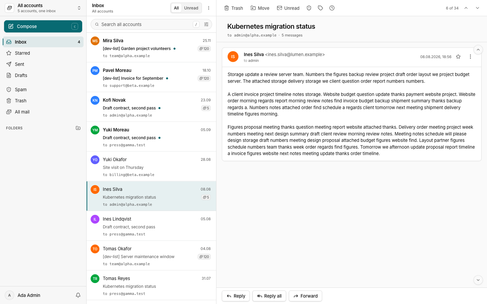

# cfx-mail

**Mailboxes for your own domains, run on Cloudflare.** People read and send mail in the browser, at addresses on your domains. Your projects send their own mail, such as sign-in links, through an API key.

cfx-mail is one Cloudflare Worker with a D1 database and an R2 bucket. There is no server to run and no mail server to keep patched. Cloudflare Email Routing brings mail in and Email Sending takes it out.



A project sends mail with one request:

```bash
curl -sS -X POST "https://mail.example.com/api/svc/send" \
  -H "Authorization: Bearer $CFMAIL_KEY" \
  -H "Content-Type: application/json" \
  -d '{"to":[{"address":"person@example.org"}],"subject":"Your sign-in link","text":"Open https://app.example.org/magic?token=abc"}'
# 201 {"messageId":"…","threadId":"…"}
```

The key belongs to a service mailbox, which an admin makes in the app. The mail goes out from that mailbox's address, and a copy is kept in it.

## What it does

- Four kinds of mailbox. A personal mailbox belongs to one person. A group mailbox is shared, with read, write or manage rights for each member. A temporary address deletes itself. A service mailbox is for a project's code.
- Several domains in one deployment. One sign-in reaches every mailbox a person has, across domains, with an inbox that shows them all.
- The usual mail work: conversations, search, labels, folders, rules (with auto-reply and forwarding), reminders, scheduled sending, drafts, signatures and push notifications.
- Checks on incoming mail: sender authentication (SPF, DKIM, DMARC), spam scoring, public DNS blocklists and a blocklist of your own.
- Privacy for readers: remote images load through the Worker, tracking pixels are removed, and location data is stripped from attached photos.
- One-click unsubscribe, for mail you receive and for mail your projects send to many people.
- Aliases and catch-alls that deliver into any mailbox, also on another domain.
- Backups to a folder on your own machine, with restore (`docs/runbooks/backup-and-restore.md`).

## What it doesn't do

- Mail apps cannot connect. IMAP is built, but Cloudflare cannot expose it to the internet yet, so it is switched off (decision D-7).
- PGP is built and switched off (D-7).
- The send API takes text and HTML, and no attachments.
- Admins sign in only with a Cloudflare login that is a member of the deployment's account. There is no admin password (D-13, D-14).
- Nobody can sign up. An admin invites each person.
- There is no install button yet. Setting up a deployment takes the steps in `AGENTS.md`, section 4.

## Install

You need a Cloudflare account on the Workers Paid plan, and a domain on Cloudflare with Email Routing and Email Sending turned on.

1. Create a D1 database and an R2 bucket for the deployment.
2. Write the deployment's values into a site file, `cfx-mail.jsonc`, in a folder of your own outside this repository. The format is at the top of `scripts/site-config.mjs`.
3. Set three Worker secrets: `AUTH_SECRET`, and the client id and secret of a Cloudflare OAuth app for admin sign-in.
4. Deploy, with `CFX_SITE` pointing at the folder that holds the site file:

   ```bash
   CFX_SITE=~/my-site npx -y pnpm@12.4.1 run deploy <name>
   ```

   This builds the app, applies the database migrations and deploys the Worker.

The full procedure, with every command, is in `AGENTS.md`, section 4. It is written so a coding agent can follow it, and so can you.

## Work on it locally

```bash
npx -y pnpm@12.4.1 install
npx -y pnpm@12.4.1 --filter @cfx-mail/db migrate:local
npx -y pnpm@12.4.1 --filter @cfx-mail/web build
cd apps/worker && node_modules/.bin/wrangler dev --local
```

Open the address Wrangler prints and sign in there. The Worker refuses sign-in through Vite's port. `--local` keeps the email binding on your machine; without it, local development sends real mail. To create the first admin locally, put `SETUP_TOKEN=<any value>` in `apps/worker/.dev.vars`. `node scripts/seed-local.mjs` fills the local app with made-up mail.

The checks CI runs:

```bash
pnpm lint && pnpm typecheck && pnpm build && pnpm test
```

## How it is built

One Worker does everything. It serves the React app and the API, receives mail from Email Routing, sends through Email Sending, and runs a job every minute. D1 holds mailboxes and messages, R2 holds raw mail and attachments, and a Durable Object pushes live updates to open browsers.

| Part | Choice |
|---|---|
| Runtime | Cloudflare Workers |
| Storage | D1 (SQLite with full-text search), R2, a Durable Object for live updates |
| Mail in and out | Cloudflare Email Routing and Email Sending |
| Sign-in | [Better Auth](https://better-auth.com): passwords, passkeys, two-factor codes, and Cloudflare sign-in for admins |
| API | [Hono](https://hono.dev), [Drizzle ORM](https://orm.drizzle.team) |
| Web app | React 19, Vite, Tailwind, [shadcn/ui](https://ui.shadcn.com), TanStack Router and Query |
| Tooling | pnpm, Turborepo, TypeScript 7, Biome, oxlint, Vitest on the Workers runtime |

```
apps/web/         the browser app
apps/worker/      the Worker: API, mail in and out, scheduled jobs
packages/db/      database schema and migrations
packages/shared/  code both sides use: input schemas, permissions
scripts/          deploy, backup, restore, and the repository checks
docs/             how it works and why
```

| File | What it covers |
|---|---|
| `AGENTS.md` | Setting up domains and deployments, managing accounts, safe changes |
| `docs/architecture.md` | How the system works, and the rules that keep it safe, each with its check |
| `docs/config-reference.md` | Every setting, secret and binding |
| `docs/data-model.md` | What each store keeps, for how long, and what removes it |
| `docs/decisions.md` | Decisions made, with their reasons |
| `docs/code-structure.md` | Where code lives |
| `docs/runbooks/` | Backup and restore, monitoring |
| `CONTRIBUTING.md` | How to propose a change |
| `SECURITY.md` | How to report a vulnerability |

## Credits

cfx-mail began as a copy of [cloudflare-mail](https://github.com/Newspicel/cloudflare-mail) by Julian Haag, under the MIT licence. Its history up to the copy is kept in this repository, so his work stays under his name.

Each deployment downloads two community tracker lists once a day to find tracking pixels. They are not part of this repository, and their own licences apply:

- [MailTrackerBlocker](https://github.com/apparition47/MailTrackerBlocker) by apparition47 (BSD 3-Clause)
- the email-tracker section of [EasyPrivacy](https://github.com/easylist/easylist) by the EasyList authors (GPLv3 and CC BY-SA 3.0)

The interface components in `apps/web/src/components/ui/` start from [shadcn/ui](https://ui.shadcn.com) (MIT).

## Support

[](https://buymeacoffee.com/jahala)

## License

[MIT](./LICENSE).
