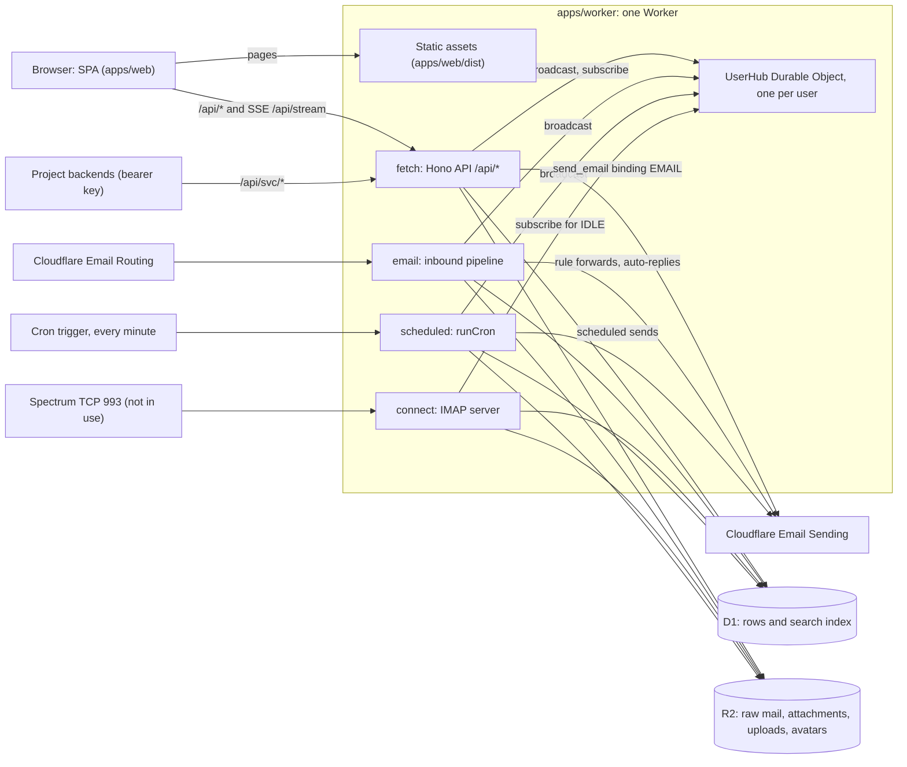

# Architecture

This document describes how cfx-mail works, as the code stands on `master`. Every statement names the file that implements it. Where something is planned or only assumed, it says so.

Related documents:

- [`config-reference.md`](./config-reference.md): every setting, secret and binding.
- [`code-structure.md`](./code-structure.md): where code lives and which folder may import which.
- [`decisions.md`](./decisions.md): decisions D-1 onward. Cited here as D-n.
- [`runbooks/`](./runbooks/): how to deploy, back up and restore.

## 1. What the system is

cfx-mail is webmail that runs entirely on Cloudflare. One Cloudflare Worker (a serverless program) serves the web app, the HTTP API, inbound mail, scheduled jobs and an IMAP server. Mail data lives in D1, Cloudflare's SQLite database, and in R2, Cloudflare's file storage. It is a private copy of Newspicel/cloudflare-mail (D-1).

One shared deployment holds the mail domains of most of the owner's projects (D-8). Its users are the owner's own staff, all known to the owner. An admin of the deployment is admin for every project in it and can reach every user's mail (D-9). Projects also send their own mail, such as sign-in links, through service mailboxes (D-7).

## 2. Binding design principles

These rules come from the invariants in `AGENTS.md` and from the decisions. "Enforced by" names the test or lint rule that fails when the rule is broken. "Not enforced" means nothing would fail.

| # | Principle | Implemented in | Enforced by |
|---|---|---|---|
| 1 | One Worker is the only runtime. A new protocol is a new handler, not a new service. | `apps/worker/src/index.ts`, `apps/worker/wrangler.jsonc` | `test/entry.test.ts` (the Worker exports exactly `fetch`, `email`, `scheduled`, `connect` and `UserHub`). `scripts/architecture.test.mjs` ("apps/worker is the only Worker in the workspace"). |
| 2 | Every mailbox route checks access through `permissions.ts`. The owner shortcut lives only there. | `apps/worker/src/permissions.ts` (`resolveAccess`, `requirePerm`, `requireEntityAccess`, `accessibleMailboxIds`) | `test/permissions.test.ts` tests the checker. `scripts/guard-proof.slowtest.mjs` removes each access check in a scratch copy and fails unless a named test catches it. `test/api/real-app.test.ts` fails when a route answers an anonymous caller without being on its public list. `test/api/route-walk.test.ts` calls every route as a signed-in user who owns nothing, with another user's ids, and fails on any answer other than 403 or 404. A new route that needs a request body fails the walk with 400 until it is given one there. |
| 3 | Live updates use Server-Sent Events (SSE, a one-way HTTP stream) through the `UserHub` Durable Object. No WebSockets, no polling. | `apps/worker/src/hub.ts`, `apps/worker/src/api/stream.ts`, `apps/web/src/lib/sse.ts`, `apps/worker/src/imap/hub-listener.ts` | `test/hub.test.ts` tests delivery, isolation between users and best-effort broadcast. `scripts/architecture.test.mjs` ("live updates use SSE") fails on WebSockets, `refetchInterval` or a `setInterval` outside its allowlist. Polling written as a `setTimeout` loop is not detected. |
| 4 | No secrets or deployment values in the repo. They are stored lazily in the `system_config` table. The exceptions are Worker secrets: `AUTH_SECRET`, the Cloudflare OAuth client (`CLOUDFLARE_CLIENT_ID`, `CLOUDFLARE_CLIENT_SECRET`) and, where used, `SETUP_TOKEN`. The base URL comes from the request. | `apps/worker/src/config.ts`, `apps/worker/src/env.ts`, `apps/worker/src/auth.ts` (`baseUrlFromRequest`) | Yes. `scripts/wrangler-config.test.mjs` fails if any block of `wrangler.jsonc` declares `vars`, if it names either secret, if `.dev.vars` is not gitignored, or if any file in the repository holds an account id, a resource id, or a hostname or address that is neither reserved nor listed in `scripts/public-hosts.txt` (D-16); `test/api/auth-secret.test.ts` tests `AUTH_SECRET`. |
| 5 | No open sign-up. The first admin is created once, by signing in with the owner's Cloudflare account (or, without the OAuth client, with the setup token). Cloudflare sign-in admits only an admin, and with the OAuth client set it is an admin's only way in: no password or passkey session for an admin. Everyone else is created by an admin or by invite. Admins cannot reset their own password by email. | `apps/worker/src/auth.ts` (`disableSignUp: true`, `sendResetPassword` returns early for admins), `apps/worker/src/api/bootstrap.ts`, `apps/worker/src/api/users.ts` | `test/api/bootstrap.test.ts` tests the setup token; `test/api/cloudflare-sign-in.test.ts` tests that Cloudflare sign-in creates only the first admin, admits only admins, and is the admin's only way in. `test/api/auth-closed.test.ts` fails when public sign-up creates a user or an admin gets a reset email. |
| 6 | R2 key layouts are a contract (section 4). A client may only refer to keys under its own `draft/<userId>/` prefix. | `apps/worker/src/mail/blob-keys.ts` builds every key, holds the one `sanitizeFilename` and the `draft/<userId>/` ownership check. `mail/ingest.ts`, `mail/send.ts`, `api/attachments.ts`, `api/avatar.ts`, `api/drafts.ts`, `cron.ts` and `mail/attachment-keys.ts` use it. | `test/blob-keys.test.ts` pins every layout through the code that writes it (ingest, send, composer upload, avatar upload), filename handling included, and the ownership check on `/draft-blob` and draft delete. `test/api/foreign-attachment-keys.test.ts` refuses foreign keys on send, schedule and drafts. A key built outside `blob-keys.ts` is not detected. |
| 7 | Gateway PGP is not end-to-end. The Worker holds the mailbox key. Mail is never rejected on a PGP failure, and private keys never leave the API. | `apps/worker/src/mail/receive.ts`, `apps/worker/src/mail/pgp.ts`, `apps/worker/src/api/mailboxes.ts` | `test/receive.test.ts` ("stores PGP mail undecrypted when the mailbox key cannot be unwrapped"). `test/api/mailboxes.test.ts` ("never leaks the private key", "returns only public material"). |
| 8 | Mail never fails on a best-effort step. Spam scoring, PGP and push must not block delivery. | `apps/worker/src/mail/receive.ts` (`afterStore`, `defer`), `apps/worker/src/mail/dnsbl.ts` (`rawAnswers` swallows DNS errors) | Yes. `test/receive.test.ts` covers a failed member lookup, a failed deferred step (push and rule sends run through the same `defer`) and a failed PGP unwrap. `test/dnsbl.test.ts` covers a DNS failure. `test/receive.test.ts` ("delivers with no spam verdict when spam scoring fails") covers the spam step. |
| 9 | `HTTPException` (Hono's HTTP error) is used only in `api/`. Everything below throws `AppError` with a transport-neutral code. | `apps/worker/src/errors.ts`; translated in `apps/worker/src/api/index.ts` (`onError`) and `apps/worker/src/imap/session.ts` | `.oxlintrc.json` (`no-restricted-imports`) fails on any import of `hono/http-exception` outside `apps/worker/src/api/`. |
| 10 | Spamhaus: the sending host or a name the sender asserts can refuse mail. Content only scores. Lookups never block mail. | `apps/worker/src/mail/dnsbl.ts`, `apps/worker/src/mail/spam.ts` | `test/dnsbl.test.ts`, `test/spam.test.ts`, `test/receive.test.ts` ("Spamhaus DQS"). |
| 11 | `dmarc=pass` removes the forgery signals and nothing else. Spam phrasing does not count against authenticated mail. | `apps/worker/src/mail/spam.ts` | `test/spam.test.ts` ("refuses a DBL-listed sender domain even when DMARC passes", "does not let spam phrasing alone flag authenticated mail"). |
| 12 | IMAP folders are derived, never stored. A message that returns to a folder gets a new, higher UID. Mail pipelines never write IMAP tables. | `apps/worker/src/imap/store.ts` | `test/imap-session.test.ts` ("gives a departed-and-returned message a fresh UID"). `scripts/architecture.test.mjs` ("only imap/store.ts touches the IMAP UID tables"). |
| 13 | Deleting a mailbox, a user or a domain goes through the staged purge. Nothing deletes a mailbox's mail in one statement. | `apps/worker/src/mailbox-purge.ts`, `apps/worker/src/cron.ts`, `apps/worker/src/api/users.ts`, `apps/worker/src/api/domains.ts` | `test/api/destructive-deletes.test.ts`, `test/cron.test.ts`. |
| 14 | Migrations are append-only. Production data exists, so tables are never dropped and recreated. | `packages/db/drizzle/` | `scripts/migrations.test.mjs` fails when a migration's contents change after it was added (fingerprints in `packages/db/drizzle/sealed.json`; a new migration fails until its line is added, and the message gives the line) or when the journal and the files disagree. |
| 15 | Deploying needs the owner's explicit go (D-5). Claude runs the deploy; a fix the owner asks for carries the go to ship it (D-12). | `scripts/deploy.sh` | Not enforced in code, by choice (D-12): a check that stops Claude would only move the typing to the owner. |

## 3. Components

The Worker's entry is `apps/worker/src/index.ts`. It exports four handlers and the `UserHub` class.

- `fetch` sends `/api/*` to the Hono app built by `buildApi()` in `apps/worker/src/api/index.ts`. Other paths go to the static assets through `env.ASSETS`, and `withSecurityHeaders` adds the security headers on the way out. `wrangler.jsonc` sets `run_worker_first: true`, so every request reaches the Worker, and `not_found_handling: "single-page-application"` serves `index.html` for app routes.
- `email` calls `handleInbound` in `apps/worker/src/mail/receive.ts` (section 5.1).
- `connect` calls `handleImapConnection` in `apps/worker/src/imap/index.ts`. IMAP is built but not in use (section 10).
- `scheduled` awaits `runCron` in `apps/worker/src/cron.ts`. The trigger is `*/1 * * * *` in `wrangler.jsonc`. `runCron` runs fourteen steps in order, each isolated so one failure does not skip the rest: scheduled sends, reminders, temp mailbox expiry, Trash purge (30 days), service mailbox retention (30 days), pending mailbox purges, deleted users, rate-limit counter pruning, expired sessions, the rule-send log past its longest window, used invites past their expiry, the hourly sweep of R2 uploads and avatars nothing refers to, the hourly DNS check of domains, and the daily tracker-list refresh.

The Durable Object `UserHub` (`apps/worker/src/hub.ts`) is one instance per user, named by user id. It keeps open SSE streams in memory and stores nothing. It has two internal paths: `/subscribe` opens a stream and `/broadcast` writes one event to every open stream. It pings every 25 seconds while a stream is open.

D1 is bound as `DB` and holds every row, including the full-text search index. R2 is bound as `BLOBS` and holds every byte of mail. Section 4 describes both.

The single-page app (SPA) is `apps/web`: React 19, TanStack Router for routes, TanStack Query for data. Vite builds it into `apps/web/dist`, which the Worker serves as static assets.

- Entry: `apps/web/src/main.tsx` creates one `QueryClient` (`lib/query-client.ts`) and the router. A 401 from any query or mutation sends the browser to `/login`. Queries retry network and 5xx failures three times and never retry a 4xx.
- Routes (`apps/web/src/routes/`): public pages `/login`, `/forgot-password`, `/reset-password`, `/two-factor` and `/accept-invite`. The guarded `/app` tree holds the mailbox list and thread view (`/app/m/$mailboxId`, `/app/m/$mailboxId/t/$threadId`), folders (`/app/folder/$folderId`), `/app/search`, `/app/settings` and `/app/admin`. `/compose` is a standalone composer window. `/app` and `/compose` redirect to `/login` when `GET /api/me` returns no user (`lib/current-user.ts`). `/app/admin` only adapts its tabs to the role; the API enforces admin rights.
- Data: every request goes through a typed Hono RPC client (`lib/api.ts`). It imports the API's route types from the Worker type-only, so a wrong path or body fails `tsc`. Query definitions are in `lib/queries.ts` and keys in `lib/query-keys.ts`.
- State: server data lives in the TanStack Query cache. Live events patch or invalidate it (`lib/sse.ts`, `lib/invalidate.ts`). The composer's open state is a small module store (`components/compose/compose-store.ts`). Drafts autosave to the server (`components/compose/use-draft-persistence.ts`), and uploads go to `/api/attachments/upload` (`components/compose/use-attachments.ts`). User preferences ride on the Better Auth user row (`lib/prefs.ts`). Only the theme is kept in `localStorage` (`lib/theme.ts`).
- The service worker `apps/web/public/sw.js` handles push notifications and skips `/api/` requests.

The app shell (sidebar, top bar and their layout in `components/app-shell.tsx`, `sidebar.tsx`, `top-bar.tsx`) follows decision D-10 and `apps/web/DESIGN_GUIDE.md`. This document does not describe the visual layout.

## 4. Information model

The schema is `packages/db/src/schema.ts`; enum values are in `packages/db/src/enums.ts`. Migrations are in `packages/db/drizzle/`, numbered from `0000`. How long each table and bucket prefix keeps its data is in [`data-model.md`](./data-model.md). Ids are UUID strings.

### Tables

| Table | What a row is | Relations and notes |
|---|---|---|
| `user` | A person who can sign in | Better Auth table with admin-plugin fields `role`, `banned`, `banReason` and two-factor fields. `banReason = "pending-delete"` marks a user being deleted (`auth.ts`, `BAN_REASON_PENDING_DELETE`). `preferences` holds the app's JSON preferences. |
| `account` | A sign-in credential | Belongs to a `user`. The password hash sits here (`providerId = "credential"`). |
| `session` | A signed-in browser | Belongs to a `user`. Read from D1 on every request; there is no cookie cache (`auth.ts`). |
| `verification`, `two_factor`, `passkey`, `rate_limit` | Better Auth's own state | Reset tokens, TOTP secrets, WebAuthn keys and sign-in rate counters. |
| `user_invite` | A pending invitation | Single-use `token`, 7-day expiry (`api/users.ts`). |
| `domain` | A mail domain served by this deployment | `allowedKinds` is a bitfield of mailbox types (`packages/shared/src/permissions.ts`, `MailboxKind`). `spfOk`, `dkimOk`, `dmarcOk` come from the DNS check (`mail/dns.ts`). |
| `domain_grant` | Which mailbox types a non-admin user may create on a domain | Key (`domainId`, `userId`). Checked by `mailbox-access.ts`. |
| `mailbox` | One address, `localPart@domain` | `type` is `personal`, `group`, `service` or `temp`. Owned by one `user`. Holds signature, Reply-To, spam level, PGP keys (private parts wrapped), the service key hash and `pendingPurge` (`empty` or `delete`). The address is unique except for a mailbox being deleted. |
| `mailbox_member` | A user's access to a mailbox they do not own | `perms` is a bitfield of READ, WRITE, MANAGE (`packages/shared/src/permissions.ts`, `Perm`). The owner needs no row. |
| `redirect` | An inbound-only alias | Delivers `localPart@domain` (or `*`, the catch-all) into `targetMailboxId`. |
| `thread` | A conversation inside one mailbox | Cached `msgCount`, `unreadCount`, `participants`, `lastMsgAt`. `trashed` and `spam` are thread-level states. `subjectNorm` is lowercased for matching replies; the API shows a thread under its first message's subject, read in the list query (`firstMessageSubject` in `api/serialize.ts`). |
| `message` | One stored email | Belongs to a `thread` and a `mailbox`. `direction` is `in` or `out`. Holds headers, `snippet`, `bodyText` (for search), `flags` (`packages/shared/src/flags.ts`), spam result, PGP result and the R2 keys `rawR2Key` and `plainR2Key`. A unique index stops a second copy of the same inbound delivery (`message_inbound_delivery_uq`, migration 0047). |
| `attachment` | One attachment of a message | `r2Key` points into `att/`. |
| `draft` | An unsent message | Belongs to a user and a mailbox. A scheduled send is a draft with `scheduledFor` and a frozen `scheduledPayload`. |
| `label`, `message_label` | Per-mailbox labels and their messages | Labels belong to a mailbox, so every member sees them. |
| `folder`, `thread_folder` | Per-user folders and which threads a user filed there | Folders belong to a user, not a mailbox. |
| `rule`, `rule_send_log` | Per-mailbox automation and its sending log | Conditions and actions are JSON (`RuleCondition`, `RuleAction` in `schema.ts`). The log caps forwards and auto-replies. |
| `reminder` | A reminder or "no reply yet" follow-up on a thread | Fired by the cron. An inbound reply cancels a pending follow-up (`mail/receive.ts`). |
| `system_config` | Instance-wide key and value | Secrets and settings. Every key is listed in `config-reference.md`. |
| `blocklist`, `block_request` | Deployment-wide sender blocks, and users' requests for one | Admins manage both (`api/admin-block.ts`). |
| `push_subscription`, `mailbox_notify` | Web Push endpoints and per-mailbox notification level | |
| `contact_key` | A correspondent's PGP public key, per mailbox | PGP is not in use. |
| `app_password`, `imap_folder`, `imap_uid` | IMAP credentials and UID bookkeeping | IMAP is not in use. |
| `rate_limit_counter` | The app's own fixed-window counters | `rate-limit.ts`. Pruned by the cron. |

Deleting a row cascades through foreign keys (for example `mailbox` to `thread` to `message` to `attachment`). R2 objects have no cascade, so code collects their keys first (`mail/blobs.ts`).

### R2 key layouts

Other code parses these paths, so a change needs a migration of existing objects (invariant 6). `apps/worker/src/mail/blob-keys.ts` builds every key below.

| Key | Written by | Read by | Deleted by |
|---|---|---|---|
| `raw/<mailboxId>/<uuid>.eml` | `mail/ingest.ts` (inbound and import) | `api/message-body.ts` (`/body`, `/bodies`), `api/messages.ts` (`/raw`, trust-sender), `api/svc.ts`, `mail/quote.ts`, `imap/store.ts` | `mail/blobs.ts` callers: cron purges, `api/threads.ts`, `api/messages.ts`, `imap/store.ts`; `ingestRaw`'s undo |
| `raw/<mailboxId>/sent/<messageId>.eml` | `mail/send.ts` | as above | as above; `cleanupFailedSend` in `mail/send.ts` |
| `plain/<mailboxId>/<uuid>.eml` | `mail/ingest.ts`, for decrypted PGP mail | `api/message-body.ts` (`/body`, `/bodies`) | as for `raw/` |
| `att/<messageId>/<index>-<filename>` | `mail/ingest.ts`, `mail/send.ts` | `api/attachments.ts`, `api/messages.ts` | as for `raw/` |
| `draft/<userId>/<uuid>-<filename>` | `api/attachments.ts` (upload) | `mail/send.ts` (copies into `att/`), `api/attachments.ts` (`/draft-blob`) | `api/drafts.ts` on draft delete; `cron.ts` after a scheduled send |
| `avatar/<userId>/<uuid>` | `api/avatar.ts` | `api/avatar.ts` | `api/avatar.ts`, when a new avatar replaces it |

Filenames in keys are reduced to `[a-z0-9._-]` and 128 characters. No job lists the `draft/` prefix, so an upload that no draft refers to stays in the bucket. The backup script finds avatar keys by parsing `user.image` (`scripts/backup/lib.mjs`, `blobFiles`).

### Search index

`message_fts` is an FTS5 virtual table (SQLite full-text search). Migration `0013_message_fts_body.sql` creates it by hand, because Drizzle cannot express it, so it is not in `schema.ts`. It indexes `subject`, `snippet`, `body`, `from_text` and `to_text`, keeps `message_id` and `mailbox_id` unindexed, and uses the `porter unicode61 remove_diacritics 2` tokenizer. Three triggers keep it in step with `message`:

- `message_fts_ai` inserts a row after each message insert.
- `message_fts_ad` deletes it after a message delete.
- `message_fts_au` rewrites it when `subject`, `snippet`, `from_name` or `from_addr` change. Changes to `body_text` or `to_text` alone do not reach the index; no code updates those columns after insert.

`api/search.ts` queries it with `MATCH`, limited to the mailboxes from `accessibleMailboxIds`. The backup skips the index and restore rebuilds it through the insert trigger ([`runbooks/backup-and-restore.md`](./runbooks/backup-and-restore.md)).

## 5. Core flows

### 5.1 Inbound mail

`handleInbound` in `mail/receive.ts`:

1. Splits the envelope recipient. Plus-addressing (`hi+tag@`) matches the base local part.
2. Finds the domain, then the mailbox. A mailbox being deleted is skipped. Without a mailbox it tries an exact `redirect`, then the domain's `*` redirect.
3. Refuses with `setReject` when the address is invalid, the domain or address is unknown, a temp mailbox has expired, a service mailbox is send-only, sender equals recipient, or the size is over 25 MiB. A blocked sender gets the same "Address not found" as an unknown address (`mail/blocklist.ts`). The block is checked on the envelope sender, then on the header From after parsing.
4. Reads and parses the raw message (`mail/mime.ts`). If this mailbox already holds the same Message-ID delivered to the same address, it returns without storing, so a sender's retry is accepted once.
5. PGP, if the mailbox has it on: decrypts and verifies. Any failure is logged and the message is stored as it arrived.
6. Spam (`mail/spam.ts`), unless the mailbox's filter is off. A Spamhaus listing that warrants refusal rejects here, with the listing named.
7. Rules (`mail/rules.ts`). A `hardBlock` rule rejects. Mark-read and mark-spam feed into the store.
8. Stores the message with `ingestRaw` (`mail/ingest.ts`): raw blob first, then attachments, then one D1 batch with the message row, its attachment rows and the thread update. On any failure it deletes the blobs and the thread row it created, then rethrows. Threading is in `mail/threads.ts`: a reply-header match joins a thread only when the thread is recent and the sender is already a participant or writes through the same mailing list the thread came from (its `List-Id`); unauthenticated mail scored as spam always gets its own thread.
9. After the store nothing may fail delivery. Rule labels and folders are applied with failures logged. Follow-up reminders on the thread are cancelled. Rule forwards and auto-replies run (`mail/rule-sends.ts`), skipped for spam, capped at 50 per mailbox per hour, and auto-replies only to authenticated senders. A `new_message` event goes to the owner and every member through `UserHub`. Push notifications go out unless the mail was filed as spam or auto-read (`mail/push.ts`).

Failure behaviour: any throw before step 8 completes is logged once as `inbound_failed` with ids and the step name only, then rethrown to Email Routing. What the sending server sees after a throw is not yet confirmed. Steps in 9 run under `ctx.waitUntil` and log `inbound_deferred_failed` or `inbound_post_store_failed`.

### 5.2 Sending

`POST /api/messages/send` in `api/messages.ts` checks the hourly send limit (60 per user, `rate-limit.ts`), WRITE on the mailbox and the attachment key prefix. It builds the reply or forward quote on the server (`mail/quote.ts`). Then `sendFromMailbox` in `mail/send.ts`:

1. Refuses more than 50 recipients or a message over 5 MiB, before anything is stored. These are Cloudflare Email Sending limits.
2. Resolves the From address. Only the mailbox's own address or a plus-alias of it is accepted.
3. Resolves the thread, then writes the Sent copy (`raw/<mailboxId>/sent/…`) and the message row.
4. Copies attachments into `att/` and records them, then calls `env.EMAIL.send`.
5. If step 4 throws, it deletes the message row, the blobs and a thread left empty, and answers 502 (`AppError("upstream")`). A retry starts clean.
6. On success it adopts the Message-ID the platform returns, bumps the thread, broadcasts `message_sent` and creates a follow-up reminder if asked.

### 5.3 Scheduled sends

`POST /api/drafts/:id/schedule` (`api/drafts.ts`) checks WRITE and attachment keys, then freezes the payload on the draft, pinned to the draft's mailbox. `dispatchScheduledSends` in `cron.ts` runs each minute, up to 50 drafts:

1. Claims a due draft with one `UPDATE … RETURNING` that moves `scheduledFor` ten minutes ahead (the lease) and counts the attempt. Only the tick that gets the row back sends it, so overlapping ticks send once.
2. Re-checks that the author is not banned and still has WRITE, then the shared hourly send limit.
3. Sends through `sendFromMailbox`.
4. Lost access hands the draft back with an error and a `scheduled_send_failed` event. Over the limit defers it five minutes without counting the attempt. Other failures retry on the next tick, up to three attempts, then hand the draft back.
5. After a send it deletes the draft and its `draft/` uploads. If that delete fails the cleanup is logged and the mail may be sent again when the lease runs out (an open audit item).

`test/scheduled-sends.test.ts` covers the claim, the re-checks and the limit.

### 5.4 Reading a thread

1. The SPA loads `GET /api/threads/:id` (READ checked by `requireEntityAccess`).
2. It loads the bodies of the messages on screen with `GET /api/threads/:id/bodies?ids=…`, at most 50 per request (`api/threads.ts`; the web app gathers them in `lib/body-batcher.ts`). Only messages of that thread are served. The composer's quoted message uses `GET /api/messages/:id/body` (`api/messages.ts`). Both routes render through `api/message-body.ts`: the server reads `plainR2Key` or `rawR2Key` from R2 and parses it.
3. For HTML it removes known tracking pixels (`mail/trackers.ts`), rewrites remote images to signed `/api/messages/proxy-image` URLs (`mail/img-proxy.ts`, HMAC with the auth secret), rewrites `cid:` images to the attachment route, and strips script-capable tags and `javascript:` URLs (`mail/sanitize.ts`). The response is revalidated by ETag on every use, so a browser cache never serves it after access ends.
4. The browser sanitises again with DOMPurify (`apps/web/src/lib/sanitize-email.ts`) and renders the result in a sandboxed iframe without `allow-scripts` and with its own content policy (`apps/web/src/components/email-frame.tsx`).
5. The image proxy accepts only URLs it signed, re-checks every redirect against the SSRF guard (`ssrf.ts`), allows images only, caps size at 10 MiB, times out after 5 seconds, and is limited to 300 requests per user per minute.

### 5.5 Live updates

1. Inside `/app`, `connectStream` (`apps/web/src/lib/sse.ts`) opens an `EventSource` on `/api/stream`.
2. `api/stream.ts` opens the stream on the caller's own `UserHub`, named by their user id, so no one can subscribe to another user.
3. Code that changes mail calls `broadcastToUsers` (`hub.ts`). A failed broadcast is logged and never fails the action.
4. The SPA patches or invalidates its query cache per event type (`HubEvent` in `packages/shared/src/events.ts`). On a stream error it probes `GET /api/me` at most every 10 seconds and goes to `/login` on a 401.

The hub keeps no history. Events sent while a browser is disconnected are not replayed.

### 5.6 Authentication and authorisation

- Better Auth (`auth.ts`) handles `/api/auth/*` with email and password, TOTP two-factor and passkeys. Sessions last 30 days and renew daily. Every request reads the session row from D1, so a deleted session stops working at once. A ban, a deletion and a password reset delete sessions (`api/users.ts`, `revokeSessionsOnPasswordReset`). The cookie is `SameSite=Lax` and bound to the request's origin.
- Accounts: the first admin is the first person through Cloudflare sign-in on an empty deployment (`auth.ts`, `admitCloudflareUser`); on a deployment without the OAuth client, `POST /api/bootstrap` with `SETUP_TOKEN` (`api/bootstrap.ts`). Others are created by an admin (`POST /api/users`) or by invite (`POST /api/users/invites/accept`). Admins sign in only through Cloudflare (D-14).
- `sessionMiddleware` (`middleware.ts`) attaches the user to every `/api/*` request after the auth routes. `requireUser` answers 401. `requireAdmin` reads role and ban from D1 and answers 403.
- Mailbox access: `resolveAccess` in `permissions.ts` gives the owner all bits, gives a member their `perms`, and treats a mailbox being deleted as gone. Routes ask for READ, WRITE or MANAGE through `requirePerm` or `requireEntityAccess`. Mailbox creation is checked by `mailbox-access.ts` against `domain.allowedKinds` and the user's `domain_grant`; admins bypass the grant.
- Admin routes (`api/admin.ts`, `api/admin-block.ts`, most of `api/users.ts`, mutations in `api/domains.ts`) need `requireAdmin` and do not use `permissions.ts`.

### 5.7 Deletion and purge

- A mailbox delete (owner via `DELETE /api/mailboxes/:id`, admin via `DELETE /api/admin/mailboxes/:id`) or an admin "empty" calls `markMailboxPurge` (`mailbox-purge.ts`). This sets `pendingPurge` and `purgeStartedAt`. A delete-pending mailbox reads as gone at once and its address is free.
- Each minute `purgePendingMailboxes` (`cron.ts`) drains up to five pending mailboxes in batches of 100 threads, at most 1,000 threads per tick. It deletes blobs first, then the threads. A finished `delete` drops the mailbox row. A finished `empty` clears the flag. An `empty` removes only threads last active before it was requested, because the mailbox keeps receiving.
- A user delete (`DELETE /api/users/:id`, body `{ deleteMailboxIds }`) marks the mailboxes the admin ticked for deletion and hands every other mailbox the user owns to that admin (`handOverMailbox` in `mailbox-owner.ts`), then bans the user with reason `pending-delete` and deletes their sessions and app passwords in one batch. `deletePurgedUsers` in `cron.ts` drops the user row once they own no mailbox.
- A domain delete (`api/domains.ts`) is refused with 409 while any mailbox, including one being purged, is on the domain.
- Expired temp mailboxes are marked for deletion by the cron and drained the same way.
- Single messages can be deleted permanently only from Trash or Spam (`api/messages.ts`). Threads trashed for 30 days are purged by the cron.

### 5.8 Backup and restore

`scripts/backup.mjs` and `scripts/restore.mjs` copy the database and the referenced R2 objects through wrangler. The procedure and its limits are in [`runbooks/backup-and-restore.md`](./runbooks/backup-and-restore.md). The tables left out are listed in `scripts/backup/lib.mjs` (`SKIPPED`). `scripts/ops/backup-daily.sh` runs the backup once a day and keeps dated copies; a launchd template for it is in `scripts/ops/`, not installed.

## 6. What is proven and what is assumed

Worker tests run in a real Workers runtime against real D1 and R2 through Miniflare (`apps/worker/vitest.config.ts`). Behaviour covered by them:

- Inbound: all-or-nothing storage, duplicate guard, aliases, service mailboxes, spam filing, threading under concurrent delivery, Spamhaus refusals (`test/receive.test.ts`, `test/ingest.test.ts`, `test/threads.test.ts`, `test/spam.test.ts`, `test/dnsbl.test.ts`).
- Sending: limits, persist-then-rollback, scheduled sends (`test/send.test.ts`, `test/scheduled-sends.test.ts`).
- Access: the permission checker, default deny on the real app, session revocation, bootstrap, the auth secret (`test/permissions.test.ts`, `test/api/real-app.test.ts`, `test/api/access-revocation.test.ts`, `test/api/bootstrap.test.ts`, `test/api/auth-secret.test.ts`).
- Purges and deletes (`test/cron.test.ts`, `test/api/destructive-deletes.test.ts`).
- Hostile content: sanitiser, image proxy, SSRF guard, trackers, unsubscribe (`test/sanitize.test.ts`, `test/img-proxy.test.ts`, `test/ssrf.test.ts`, `test/trackers.test.ts`, `test/unsubscribe.test.ts`, `test/hostile-input.test.ts`).
- Web: logic in `apps/web/src/lib/*.test.ts` and the frame sandbox (`components/email-frame.test.ts`). No component is rendered in a test and there is no browser test.
- Health check: `test/api/health.test.ts`.
- Backup helpers and the daily backup's retention rule: `scripts/backup/lib.test.mjs`, `scripts/ops/*.test.mjs`.

Assumed, not yet verified on Cloudflare:

- What a sending server sees when the inbound handler throws: a temporary or a permanent failure (see section 5).
- Backup and restore against Cloudflare: the round trip is tested on local storage only.
- That the app shell gets its security headers on the deployed site. `AGENTS.md`, section 4, step 7, has the one-line check.
- The behaviour of the `EMAIL` binding. Tests fake it, so its error messages and its returned Message-ID are untested.
- That a `UserHub` stream survives as long as the browser keeps it open. When the platform ends it, the browser reconnects and missed events are lost.
- Inbound delivery from Email Routing. `wrangler dev` cannot trigger `email()`; tests call `handleInbound` with a stub message.

## 7. Integration contracts

### HTTP API

`apps/worker/src/api/index.ts` mounts every route group in one chain. Anonymous access is pinned by the `PUBLIC` list in `test/api/real-app.test.ts`; every other route must answer 401 without a session.

| Prefix | File | Who may call |
|---|---|---|
| `/api/bootstrap` | `bootstrap.ts` | Anyone. `POST` needs `SETUP_TOKEN` and an empty user table. |
| `/api/svc/*` | `svc.ts` | A service mailbox's bearer key. No session. |
| `/api/auth/*` | Better Auth | Its own rules and rate limits. |
| `/api/health`, `/api/me` | `index.ts` | Anyone. `/api/health` sits before the session middleware, runs one D1 statement and one R2 lookup, and answers 200 or 503 naming the failed part. `/api/me` returns `{ user: null }` when signed out. |
| `/api/users` | `users.ts` | Invite lookup and accept: anyone with the token. `/directory`: signed in. The rest, including `/:id/mailboxes` for the delete dialog: admin. |
| `/api/domains` | `domains.ts` | List: signed in. Settings and changes: admin. |
| `/api/admin`, `/api/admin/block` | `admin.ts`, `admin-block.ts` | Admin. |
| `/api/mailboxes`, `/api/threads`, `/api/messages`, `/api/drafts`, `/api/labels`, `/api/folders`, `/api/rules`, `/api/attachments`, `/api/reminders`, `/api/search`, `/api/push`, `/api/app-passwords`, `/api/contacts`, `/api/avatar`, `/api/temp`, `/api/blocklist` | one file each | Signed in. Mailbox-scoped routes also check `permissions.ts`. |
| `/api/stream` | `stream.ts` | Signed in. Opens the caller's own SSE stream. |

Errors are JSON with an `error` field (`onError` in `api/index.ts`). A request that fails validation gets status 400 and the first problem as a sentence, such as `{ "error": "Not a valid regular expression." }` (`api/validate.ts`, tested by `test/api/validation-errors.test.ts`). CORS reflects only the instance's own origin. The request log writes the route pattern, status and time, never the path or query string.

### Service mailbox API

An admin creates a service mailbox and gets its key once (`POST /api/admin/service`, rotate with `POST /api/admin/service/:id/rotate`). Only the key's SHA-256 is stored (`mailbox.serviceKeyHash`). Callers send `Authorization: Bearer <key>` to:

- `GET /api/svc/info`: the address and mode.
- `POST /api/svc/send`: a message (schema `serviceSend` in `packages/shared/src/schemas.ts`), through the same `sendFromMailbox`. Limited to 600 per mailbox per hour. Its optional `headers` takes only `List-Unsubscribe` and `List-Unsubscribe-Post`, for RFC 8058 one-click unsubscribe on a project's bulk mail. The schema checks them to Cloudflare Email Sending's own rules for these headers and refuses a line break, so no header can be injected. `sendFromMailbox` adds them to the outbound message, the PGP message and the stored copy, the same way as `In-Reply-To` and `References`. The web app's own send takes no headers.
- `GET /api/svc/messages?after=<id>`: received and sent mail, 50 per page. With `after` it returns mail newer than that id, oldest first, and `nextCursor`.
- `GET /api/svc/messages/:id`: one message with text, HTML and attachment metadata.

Mode `send` rejects inbound mail. Mode `duplex` stores it for polling. The cron deletes service mail 30 days after a thread's last message. A key stops working the moment its mailbox is marked for deletion.

### Email Routing and `email()`

Email Routing hands each message to `email()` (`index.ts`, `mail/receive.ts`).

- `message.setReject(reason)` is a permanent refusal the sender sees: unknown address, size, send-only, block, Spamhaus listing, `hardBlock` rule.
- A normal return means accepted. That includes a duplicate the mailbox already holds.
- A throw is used only for failures before the message is durably stored, so the sender can retry. Whether Email Routing turns a throw into a temporary failure is unconfirmed.

### `send_email` binding

The binding is `EMAIL` with `remote: true` (`wrangler.jsonc`), so even local development sends real mail. Callers:

- `mail/send.ts`: structured send for normal mail; a raw `EmailMessage` per recipient for PGP mail.
- `mail/notify.ts`: password reset, change-of-email and invite mail. Failures are logged, never thrown.
- `mail/rule-sends.ts`: rule forwards and auto-replies as raw `EmailMessage`s from the mailbox's own address.
- `mail/unsubscribe.ts`: an unsubscribe `mailto:` with a fixed body.

Each From domain must be onboarded for Email Sending in Cloudflare ([`AGENTS.md`](../AGENTS.md), section 3.4).

## 8. Deployment shape

- One shared deployment holds several mail domains (D-8). The config still allows more deployments, so a project that needs its own admin can get one (D-2's shape).
- `apps/worker/wrangler.jsonc` is a template for local development and tests (`cfx-mail-local`). Each real deployment's values live in the private site file (D-16). `scripts/site-config.mjs` joins them with the template into a scratch folder as a named block under `env`, repeating the `DB`, `BLOBS`, `USER_HUB` and `EMAIL` bindings, because wrangler does not inherit them. Everything else is inherited.
- `CFX_SITE=<site checkout> pnpm run deploy <name>` (`scripts/deploy.sh`) joins the config, builds the web app, builds the Worker bundle in a dry run, applies D1 migrations, then deploys the Worker. Migrations always run before the new Worker goes live.
- Secrets: set `AUTH_SECRET`, `CLOUDFLARE_CLIENT_ID` and `CLOUDFLARE_CLIENT_SECRET` with `wrangler secret put` before the first request; the first admin then signs in with Cloudflare. Details in [`config-reference.md`](./config-reference.md).
- CI (`.github/workflows/ci.yml`) runs lint and typecheck, test, and build on every pull request and every push to `master`. The jobs run on GitHub's hosted runners unless the repository variable `CI_RUNS_ON` names others (D-19).
- Steps that create things in Cloudflare need the owner's go (D-5). Follow [`AGENTS.md`](../AGENTS.md), sections 3 and 4, [`runbooks/backup-and-restore.md`](./runbooks/backup-and-restore.md) and [`runbooks/monitoring.md`](./runbooks/monitoring.md).

## 9. Security baseline

| Protection | Against | Where |
|---|---|---|
| Content-Security-Policy, HSTS, `X-Frame-Options`, `nosniff`, `Referrer-Policy`, `Permissions-Policy`, COOP on the app shell | Script injection and framing of the app | `withSecurityHeaders` in `index.ts`. Probably not applied in a deployment; see below. |
| Sandboxed mail frame without `allow-scripts`, plus its own meta CSP | Script and remote loads from mail HTML | `apps/web/src/components/email-frame.tsx`, guarded by `email-frame.test.ts` |
| DOMPurify allowlist in the browser; server strip of script tags and `javascript:` URLs | Hostile mail HTML | `apps/web/src/lib/sanitize-email.ts`, `apps/worker/src/mail/sanitize.ts` |
| Tracker stripping and a signed image proxy | Read receipts and IP leaks | `mail/trackers.ts`, `mail/img-proxy.ts`, `api/messages.ts` |
| Stored bytes served `nosniff` with `sandbox` CSP; only images and PDF inline | Attachments acting as pages on our origin | `attachmentHeaders` in `api/attachments.ts`, `api/avatar.ts` |
| SSRF guard on every server-side fetch of a mail-supplied URL, re-checked on each redirect | Requests steered at internal addresses | `ssrf.ts`, used by `mail/img-proxy.ts`, `mail/push.ts`, `mail/unsubscribe.ts`, `mail/wkd.ts`, `api/push.ts` |
| Rate limits: sign-in 10 a minute and all auth routes 120 a minute per IP; sending 60 an hour per user; service sends 600 an hour per mailbox; invite accept 10 a minute per IP; image proxy 300 a minute per user; IMAP login 10 per address and 30 per IP per 15 minutes; rule sends 50 an hour per mailbox | Brute force and abuse of shared sending reputation | `auth.ts`, `rate-limit.ts`, `api/svc.ts`, `api/users.ts`, `api/messages.ts`, `app-passwords.ts`, `mail/rule-sends.ts` |
| Setup token with a constant-time compare, and an atomic first-user insert | Someone else becoming the first admin | `api/bootstrap.ts` |
| Sessions read from D1 on every request; ban, delete and reset remove sessions and app passwords | Access that should have ended | `auth.ts`, `api/users.ts`, `api/mailboxes.ts` (member removal) |
| `AUTH_SECRET` kept outside the database | Forging sessions from a database copy | `config.ts` |
| Staged deletes with blob cleanup | Losing or stranding mail on delete | `mailbox-purge.ts`, `cron.ts` |
| Same-origin CORS, `SameSite=Lax` cookie, Better Auth trusted origin set to the request's origin | Cross-site requests | `api/index.ts`, `auth.ts` |
| `Clear-Site-Data: "cache"` on sign-out, and the SPA clears push and its query cache | Mail left on a shared computer | `api/index.ts`, `apps/web/src/lib/sign-out.ts` |

The app shell's headers depend on routing. Until 2026-10-09, `wrangler.jsonc` routed only `/api/*` to the Worker first, and Cloudflare served every other path straight from static assets ([Worker script routing](https://developers.cloudflare.com/workers/static-assets/routing/worker-script/)), so the shell had no CSP or framing protection. It now sets `run_worker_first: true`. `scripts/wrangler-config.test.mjs` fails if that is narrowed again, and `test/security-headers.test.ts` checks the headers themselves.

Accepted risks:

- Admins can reach every user's mail (D-9). Better Auth's admin plugin is mounted (`authPlugins` in `auth.ts`), so `/api/auth/admin/*` lets an admin impersonate a user or set their password. `PATCH /api/admin/mailboxes/:id` re-owns a mailbox. The admin account signs in only through Cloudflare (D-14), so it rests on the owner's Cloudflare login and its two-factor.
- A member with MANAGE can add any user to a mailbox without that user's consent. This is left as is.
- The PGP master key and the Web Push private key stay in `system_config`. Neither feature is in use.
- Sending goes through Email Sending, which is in beta and allows transactional mail only; a review could pause sending for the whole account (D-3).
- CI runs pull requests on GitHub's hosted runners, never on a machine of the owner's (D-19).
- The SSRF guard cannot stop DNS rebinding, because a Worker cannot pin the resolved address (`ssrf.ts`, header comment).
- The composer's quote preview can show hidden text that the server leaves out of what is sent, and in rare malformed mail the quote sanitiser drops some visible quoted text. Both err towards sending nothing hidden.

## 10. Out of scope and not in use

- IMAP: built (`apps/worker/src/imap/`, the `connect` handler) and kept, but not in use. Reaching it needs inbound TCP for Workers (private beta) and Spectrum custom ports, an Enterprise feature (D-4, D-7). The settings page shows IMAP app passwords whether or not an admin has stored `imap_host`; without it, the host reads "(ask your admin)" (`apps/web/src/components/settings/app-passwords-section.tsx`).
- PGP: built (`mail/pgp.ts`, `mail/wkd.ts`) and kept, but not in use (D-7). It is off per mailbox by default (`pgpMode` defaults to `off`).
- Temporary mailboxes: kept for testing (D-7). They always expire: after an hour unless asked otherwise, at most 7 days (`tempTtlSeconds` in `packages/shared/src/schemas.ts`), then the cron deletes them.
- Removed (D-7): the iOS app, sender brand logos (BIMI), the AI features and the share-link table. Upstream changes to removed code are dropped when merging.
- Settings screens for unused features stay visible (D-7). D-10 moves IMAP and PGP settings under an "Advanced" group.
- Archive is not part of the D-10 shell work. It needs its own data model change.
